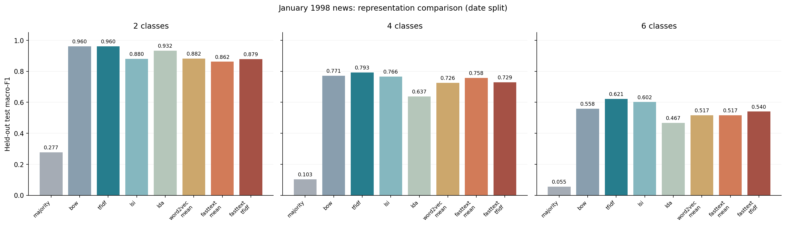
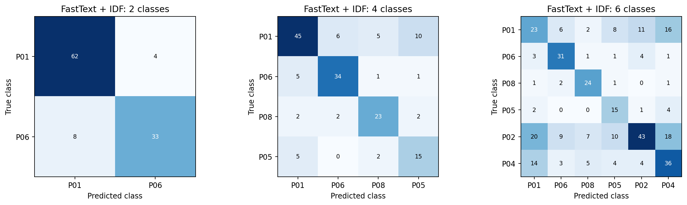

# 实验结果与结论边界

本文整理自 2026-10-22 已完成的实验产物；此次 GitHub 发布没有重新训练或根据测试集调参。仓库保留轻量汇总和图表，语料、模型、逐文预测与完整运行日志保留在本地。

## 1. 任务与数据

**分类目标是版面归属，不是人工主题标签。** 2 类为 page_01/page_06，4 类增加 page_08/page_05，6 类再增加 page_02/page_04。文章编号和版面标签不进入模型文本。

| 月份 | 原始文章 | 原始段落 | 编码替代字符 |
|---|---|---|---|
| 1998-01 | 3132 | 23258 | 0 |
| 1998-02 | 2626 | 21603 | 0 |
| 1998-03 | 2905 | 24685 | 1 |

原始共 8663 篇；移除少于 30 个有效词的短文 344 篇、精确或近重复 5 篇。清洗后 1 月 2991 篇、771,527 个词；2—3 月 5323 篇、1,655,498 个词。

GB18030 解码后按文章合并段落，沿用原始分词，去拼音、标点、纯数字和固定停用词。重复检测采用清洗文本 SHA256 与词二元组 64 位 SimHash（汉明距离 ≤ 3），保留最早文章；这不保证排除所有同事件报道。

分类划分：1 月 1—19 日训练，20—24 日验证，25—31 日测试。所有表示均只从训练文章拟合；英文与 2—3 月中文探索模型不参与分类训练。

| 任务 | 训练文章 | 验证文章 | 测试文章 |
|---|---|---|---|
| 2 | 375 | 124 | 107 |
| 4 | 622 | 236 | 158 |
| 6 | 1148 | 396 | 331 |

表示模型统一利用所有版面的 1 月训练文章进行无监督学习，分类器只用所选类别的训练文章。类别数增加时样本数也变化，不能把分数变化完全归因于类别数量。

## 2. 参数与验证集选择

词向量主配置：64 维、window=5、min_count=3、epochs=8、negative=5、ns_exponent=0.75、sample=0.001、workers=1、seed=42；FastText bucket=50,000。词典最多 20,000 词，LSI 最多 64 维，LDA 12 个主题、3 次 passes。

四类验证任务使用 IDF 加权 FastText 文章向量比较以下配置。每组 SVM C 从 0.1/1/10 中选择；其他方法也分别在验证集选择 C。分类器为 class_weight=balanced 的 LinearSVC，输入做 L2 归一化。

| FastText 配置 | 验证 macro-F1 | 选中 C | 向量训练秒数 |
|---|---|---|---|
| sg_ngram_2_4 | 0.7756 | 1.0 | 21.6 |
| sg_ngram_3_6 | 0.7973 | 10.0 | 19.7 |
| cbow_ngram_2_4 | 0.7388 | 10.0 | 9.7 |

选中 sg_ngram_3_6。固定这组参数与 C，种子 42/43/44 的验证 macro-F1 均值 0.7991、标准差 0.0113；这是同一划分下的训练随机性，不是跨划分置信区间。

| 种子 | 验证 macro-F1 |
|---|---|
| 42 | 0.7973 |
| 43 | 0.8138 |
| 44 | 0.7863 |

## 3. 独立测试结果

| 类别数 | 表示 | 测试 Accuracy | 测试 macro-F1 | 测试 weighted-F1 |
|---|---|---|---|---|
| 2 | majority | 0.3832 | 0.2770 | 0.2123 |
| 2 | bow | 0.9626 | 0.9605 | 0.9626 |
| 2 | tfidf | 0.9626 | 0.9605 | 0.9626 |
| 2 | lsi | 0.8879 | 0.8802 | 0.8873 |
| 2 | lda | 0.9346 | 0.9322 | 0.9352 |
| 2 | word2vec_mean | 0.8879 | 0.8824 | 0.8883 |
| 2 | fasttext_mean | 0.8692 | 0.8616 | 0.8692 |
| 2 | fasttext_tfidf | 0.8879 | 0.8790 | 0.8866 |
| 4 | majority | 0.2595 | 0.1030 | 0.1069 |
| 4 | bow | 0.7911 | 0.7708 | 0.7974 |
| 4 | tfidf | 0.8038 | 0.7926 | 0.8152 |
| 4 | lsi | 0.7785 | 0.7664 | 0.7827 |
| 4 | lda | 0.6519 | 0.6372 | 0.6626 |
| 4 | word2vec_mean | 0.7405 | 0.7259 | 0.7411 |
| 4 | fasttext_mean | 0.7658 | 0.7577 | 0.7675 |
| 4 | fasttext_tfidf | 0.7405 | 0.7294 | 0.7425 |
| 6 | majority | 0.1994 | 0.0554 | 0.0663 |
| 6 | bow | 0.5378 | 0.5583 | 0.5426 |
| 6 | tfidf | 0.5770 | 0.6215 | 0.5793 |
| 6 | lsi | 0.5650 | 0.6015 | 0.5663 |
| 6 | lda | 0.4532 | 0.4672 | 0.4356 |
| 6 | word2vec_mean | 0.4985 | 0.5167 | 0.4946 |
| 6 | fasttext_mean | 0.5045 | 0.5166 | 0.5016 |
| 6 | fasttext_tfidf | 0.5196 | 0.5402 | 0.5137 |

TF-IDF 在验证集上也是三个任务中表现最好的方法。独立测试中，它均优于两种 FastText 聚合方式；本实验不支持“FastText 一定优于 TF-IDF”的结论。

## 4. OOV 与验证证据

| 划分 | Word2Vec 词表内 token 占比 | FastText 词表内 token 占比 | FastText 可合成向量 token 占比 |
|---|---|---|---|
| train | 93.77% | 93.77% | 100.00% |
| validation | 88.75% | 88.75% | 100.00% |
| test | 88.96% | 88.96% | 100.00% |

可合成向量只说明有计算路径，不代表 OOV 语义准确。小规模语料、未训练充分的子词、哈希碰撞和中文分词差异都可能影响质量。

原实验核对了输入与源码 SHA256、文章/内容的划分隔离、实际表示训练文章清单。重新加载 TF-IDF、FastText 均值、FastText+IDF 后，158 篇四类测试文章的预测全部与保存记录一致；新文本通过 jieba 分词后获得有限且非零的 [1,64] 向量。

## 5. 限制与结果来源

- 版面包含混合主题和编辑排版因素；若研究真正的主题分类，需要人工标注并独立评测。
- 单月数据和部分测试类别样本有限，同事件报道仍可能跨划分。
- 额外种子只比较验证集；未开展跨年份、跨划分的最终测试稳定性评估。
- Gensim 词向量聚合 + LinearSVC 不等同于 Facebook fastText supervised；64 维与 50,000 桶的设置也不是原论文完整复现。
- 这里的训练时间来自原机器，不是跨设备吞吐基准；未测量峰值内存。

可核查的轻量产物：

- [完整汇总 CSV](results/classification_summary.csv)
- [FastText 参数验证 CSV](results/hyperparameter_validation.csv)
- [随机种子验证 CSV](results/seed_validation.csv)
- [实验来源、输入哈希与参数](results/provenance.json)

原始语料、处理后的文章、模型、源码快照、详细日志及本地 docs 不纳入本次上传。完整流程可按 [README](README.md) 准备输入后重新生成。
